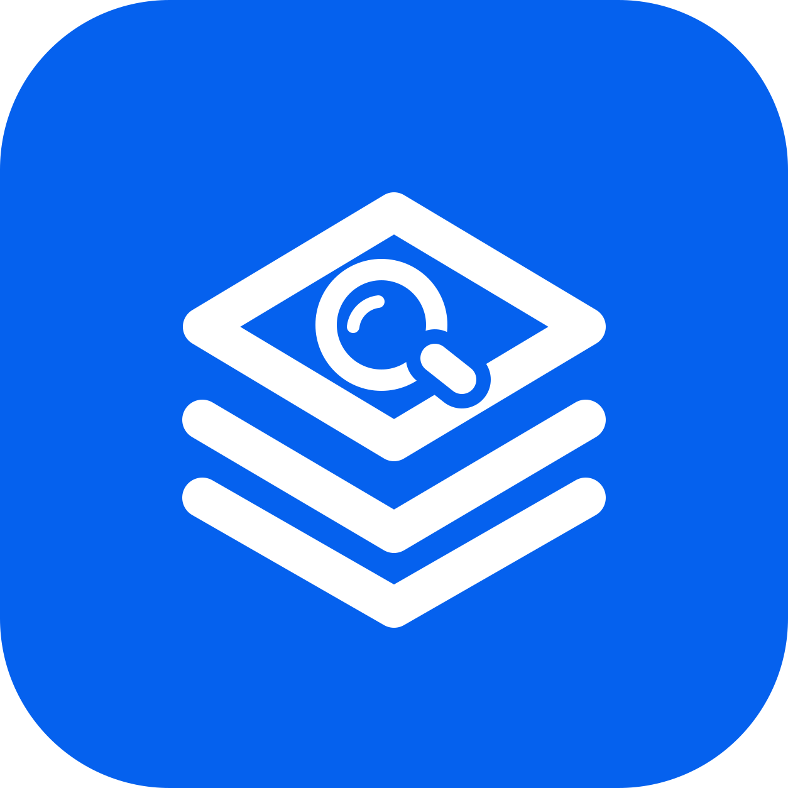
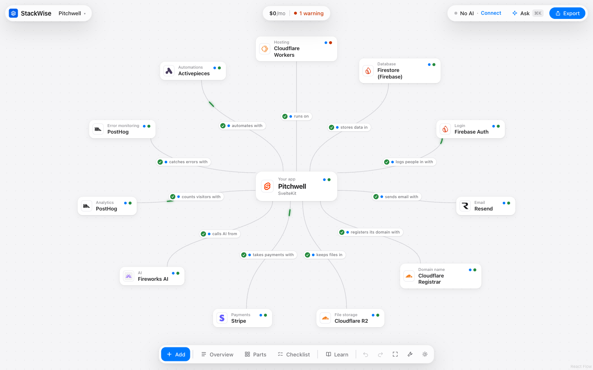
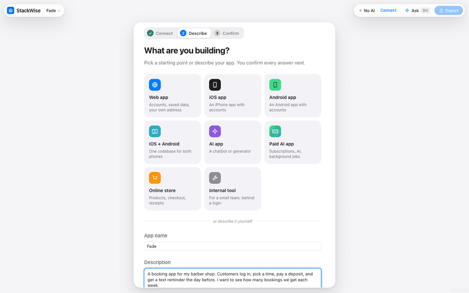

<p align="center"></p>

# StackWise

**Plan an app's stack you understand, then hand it to your coding agent.**

[](https://github.com/Mikey-Ku/StackWise/actions/workflows/ci.yml)
[](LICENSE)

StackWise is a planning tool for people building their first web apps with AI builders (Lovable, Bolt, Replit, Claude Code, Cursor). You describe the app in a paragraph. StackWise works out what it needs, asks you to confirm each guess, and lays the plan out on a canvas: your app in the middle, a card for every service it needs, a line for every connection. A rules engine checks each connection against sourced facts, so every verdict comes with a reason and a link. When the plan looks right, your coding agent gets it over MCP: the stack, the reasons, an ordered build plan and a test plan for every task.

The AI never decides whether two services work together. Rules do, from facts with a source and a date. AI reads your description, explains the plan, and drafts new facts for a person to review.

<picture>
  <source media="(prefers-color-scheme: dark)" srcset="docs/images/stackwise-plan-dark.png">
  
</picture>



**[Watch the 85-second demo](https://michaelkujr.me/projects/stackwise/)** (captioned, no sound needed), or read the write-up on the same page: the problem it solves, how it teaches, and what the rules catch. A two-minute walkthrough for giving the demo yourself is in [docs/DEMO.md](docs/DEMO.md).

## Install

### The Mac app

Download `StackWise-<version>-arm64.dmg` from [Releases](https://github.com/Mikey-Ku/StackWise/releases), open it, and drag StackWise into Applications. It's built for Apple Silicon.

The app isn't signed with an Apple developer certificate, so the first time macOS says it can't check it for malware. Right-click StackWise in Applications and choose Open, or run:

```bash
xattr -d com.apple.quarantine /Applications/StackWise.app
```

StackWise lives in the menu bar. Its server runs at `http://127.0.0.1:4310` while the app is open, so a coding agent keeps its connection when you close the window; Quit stops everything. Your plans, profile and keys are in `~/.stackwise`.

### From source

You need Node 22.9 or newer and pnpm.

```bash
git clone https://github.com/Mikey-Ku/StackWise.git stackwise && cd stackwise
pnpm install
pnpm dev
```

Open http://localhost:4310. Then, if you like:

```bash
pnpm link --global   # adds the `stackwise` command
stackwise setup      # once: connects Claude Code to StackWise
stackwise            # in any project folder: starts StackWise in the background and opens that project's plan
stackwise stop
pnpm app:build       # builds the Mac app yourself, into release/
```

Everything works without an API key. For an AI that reads your description, answers questions and explains your plan, add a key in Settings, or set `ANTHROPIC_API_KEY`, `OPENAI_API_KEY` or `GEMINI_API_KEY` in `.env.local` (see `.env.example`).

## Five minutes in

1. Projects. The first page: your plans, the projects StackWise found under your folders (plan one in a click), and examples to open.
2. Describe your app, or pick a kind of app (web, iOS, Android, both, AI app, online store, internal tool). Confirm each guess; StackWise shows the exact words behind every one. Only the follow-up questions that would change the plan are asked. Pick a priority (spend $0, launch fast, learn, ready to grow), an audience size and your builder.
3. Read the canvas. Your app in the middle, with its parts in four layers: where it runs (hosting, domain), people (login, payments, email, a phone app), data (database, files, background jobs), and outside services (AI, scraping, data sources, automations, analytics, monitoring). A check on a line means the connection works, `!` a warning, a cross that it doesn't, `?` that a fact is missing. A light flows along the lines that work. Drag any part where you want it; Tidy up puts the layers back.
4. Click anything. A card opens Details: why it was picked, every check with its reason and fix, the cost at your size, a comparison with the alternatives, and the facts behind it with their sources. A line shows what travels on it: the environment variables your code reads to reach that service. Right-click for everything else: ask, swap, let StackWise pick, learn, build this with your agent.
5. Ask (Cmd+K). A chat pane beside the canvas, one conversation per plan. Pick who answers in the composer: a coding agent in your terminal, a built-in AI with a key (and which of its models), or StackWise's own facts, which need nothing.
6. The dock. Overview (problems, close calls, accounts, cost at every size), Parts (every service by part, dragged onto the canvas; 101 options, 80 fully researched) and Checklist (accounts, keys and build steps to tick off).
7. Settings. Account (your name, where plans live), General (what a new plan starts with, the folders StackWise looks in), Appearance, Models (who answers in Ask; a key and a model per built-in AI) and Agents (your coding agents, one Connect button for Claude Code, and the MCP server's status).
8. Build it. Connect your agent and tell it to build from the plan, or export a project pack: the spec, setup, decisions, tasks with their tests, `.env.example`, and for Claude Code an agent per part, skills and `.mcp.json`.

## How it works

1. Facts. Every service is a JSON file in `data/options/` with facts a person can check: a free plan's limit, a price, whether it can push live updates to browsers. Each fact has a source URL, the date it was checked, and a status. New facts are drafts until someone reviews them on `/review`.
2. Rules. `data/rules/` say what the facts mean together: a host that falls asleep can't run background jobs; a framework that renders on the server needs a host that runs servers; two Firebase parts share one project. A rule reads at most two parts, and a missing fact makes a check "unknown", never "works".
3. Search. For your answers, size and priority, StackWise scores every stack (branch and bound, tested against brute force) and shows the best one with its close calls, so you see what nearly won and why.
4. The canvas is a view of that result. Swap a part and the rules run again; every line's mark is a verdict, not a drawing.
5. AI, optionally, has three jobs: read your description (its guesses must quote words that are really there), explain the computed plan, and draft new facts for review. It never decides compatibility.
6. Your agent gets the plan over MCP: the same engine, 15 tools, no verdicts of its own.

On disk:

```
~/.stackwise/
  profile.json      your name, theme, defaults, folders
  library.json      which plans you have and their order
  plans/<id>.json   one file per plan, shared with agents
  .env.local        AI keys, in the Mac app (from source they're in the repo's .env.local)
  server.log        the server started by `stackwise` or the app
```

The browser keeps a copy of your plans so the canvas opens instantly; the files are the record, and the newer side wins when they differ.

## Work with a coding agent

StackWise is an MCP server, so your agent uses its rules instead of guessing. In Settings, Agents, press **Connect to StackWise** on Claude Code (any agent that speaks MCP can use the same address):

```bash
claude mcp add --transport http --scope user stackwise http://127.0.0.1:4310/api/mcp
```

Then, in Claude Code: "check my StackWise plan and fix the warnings", "add web scraping and compare the options", "build the payments task". The agent can check any stack, compare options, price a plan, get setup steps, read the plan you have open and change it (its changes appear on the canvas with its reason; Undo reverses them), and get every task's build brief and test plan. Run `/mcp__stackwise__pair` and you can write to it from Ask while it works in your repo.

Every task comes with a test plan: what to check, how to keep the real service out of the tests, what not to test, and the limits StackWise knows for that service, so a test never charges a card, sends real mail or spends AI credit. The same plan is in the exported TASKS.md and in each part's build agent.

The tool reference, with an example call and response for each tool, is in [docs/MCP.md](docs/MCP.md).

## Keeping the facts true

- Facts live in `data/` as reviewed JSON with a source, a date and a status. `/review` lists the facts the rules read first, and confirming one is a two-line diff.
- A weekly GitHub workflow rereads every source with Claude and opens a pull request with anything that changed.
- `pnpm draft:option` researches a new service into a draft file for review; `pnpm check:options -- --id <id>` checks it before it joins the catalog.

## Commands

```bash
pnpm dev              # http://localhost:4310
pnpm test             # engine, AI (with a fake client), store, MCP, scripts and data checks
pnpm check:data       # only the data checks: schemas, sources, every pair gets a verdict
pnpm check:options -- --id firecrawl   # check one option file while you write it
pnpm typecheck && pnpm lint && pnpm build
pnpm app              # the Mac app in development, on top of pnpm dev
pnpm app:build        # the dmg, into release/

pnpm eval:questions   # the question ids eval cases can grade, no AI
pnpm eval:prefill     # AI pre-fill vs the keyword baseline (needs cases in evals/)
pnpm eval:plain-llm   # how often a plain LLM picks a stack that breaks a rule
pnpm check:sources    # reread every fact's source page with Claude; --apply to update
pnpm draft:option -- --id resend --name "Resend" --slot email --website https://resend.com
pnpm build:logos      # refetch logos into public/logos; -- --only <id,id> for a few
pnpm mcp              # StackWise's MCP server over stdio
```

## Where things are

```
data/                 everything StackWise knows, as JSON
  options/*.json      one file per service, with sourced facts
  rules/              capability.json and product.json
  needs.json          the questions a beginner answers
  facts.json          what each fact means and its allowed values
  slots.json          the parts of an app
  learn.json          teaching content and glossary
  logos.json          where each option's logo comes from
  planning.json       sizes, priorities and weights, builders
public/logos/         the logo files, committed
src/engine/           rules, search, cost, wiring, layers, build and test plans: no React, fully tested
src/ai/               Claude, OpenAI and Gemini: pre-fill, explain, talk (optional)
src/components/       the canvas, its panels, and the plan store
src/app/              the pages (projects, settings, learn, review) and the API routes
src/local/            ~/.stackwise: profile, library, found projects, installed agents
src/project/          a linked project folder: what it is, its env variable names, its icon
src/mcp/              the MCP server, its stdio command, shared plans and pairing
electron/             the Mac app
scripts/              evals, source checker, option drafter, logo fetcher
evals/                eval cases (written by a person) and how to run them
docs/                 MCP.md, LEARNING.md, DECISIONS.md, DATA.md, DEMO.md, images/
```

Start with [docs/LEARNING.md](docs/LEARNING.md) for how it works, and [docs/DECISIONS.md](docs/DECISIONS.md) for why it's shaped this way.

## Questions

**My agent says ECONNREFUSED, or Settings says it isn't connected.** StackWise has to be open: the Mac app, `stackwise`, or `pnpm dev`. The address must be `127.0.0.1:4310`, not `localhost` (on macOS `localhost` resolves to `::1` first, and StackWise listens only on 127.0.0.1). Settings shows each agent's connection; Connect again fixes a wrong address.

**"No plan is shared yet."** Open Ask (Cmd+K) and send the agent a message, or pick "Share this plan with agents" in the Answering menu.

**macOS says the app is damaged or can't be checked.** It isn't signed with an Apple certificate. Right-click it and choose Open, or run the `xattr` command above.

**Port 4310 is in use.** Another StackWise is running: quit the app, or `stackwise stop`. `pnpm dev` uses the same port.

**Which model answers?** Settings, Models: each built-in AI has a model picker (Claude starts on `claude-opus-5`), and the chat pane shows the model beside the answerer. The choice is saved as `STACKWISE_MODEL`, `OPENAI_MODEL` or `GEMINI_MODEL` in StackWise's `.env.local`.

**Where are my plans?** `~/.stackwise/plans/`, one JSON file each. A plan file you exported (`stackwise.plan.json`) opens with "Open plan file" on the Projects page, and a share link carries the whole plan.

**Can I use it without any AI?** Yes. Every verdict, cost, checklist, export and MCP tool works from the facts. Ask answers from the facts too.

**How do I add a service or fix a fact?** Each service is a file in `data/options/`. `pnpm draft:option` writes a first draft with Claude, `pnpm check:options` checks it, and every fact needs a source URL and a date. See [docs/DATA.md](docs/DATA.md).

**Does it send anything anywhere?** No. It listens on 127.0.0.1. The only outside calls are to an AI provider you added a key for, when you use it, and the logo fetcher when you run it.

**Intel Mac, Linux, Windows?** Run from source (the dmg is Apple Silicon only). Linux works; Windows isn't tested.

## Safety

StackWise runs on your computer, writes project files, saves AI keys for you and runs your agent's connect command, so it only answers you:

- It listens on 127.0.0.1, never on your network.
- Its API answers only StackWise's own page (checked with the Origin and Sec-Fetch-Site headers) and programs on this computer, like Claude Code. Every POST must be JSON.
- It never shows a key or env value back to the page. The Project panel writes values into your project's `.env.local` and only reports which names are set.
- Don't put it behind a proxy or on a server: it has no accounts. `STACKWISE_PAIRING=off` turns off pairing and everything that writes files.

## Not built yet

- Syncing plans between computers (plans are files in `~/.stackwise`; share links and plan files move them)
- Checks for services StackWise doesn't list, and for lines between two parts that no rule reads (they say "not checked")
- Planning a phone app on its own (a phone app can be added to a web plan today)
- A Windows or Intel Mac build of the app
- The eval cases: `evals/prefill-cases.json` is empty on purpose, see [evals/README.md](evals/README.md)
- Reviewed facts: every fact is still a draft until someone checks it on `/review`, see [docs/DATA.md](docs/DATA.md)

## Contributing

Pull requests are welcome. `pnpm test && pnpm typecheck && pnpm lint` has to pass; the data tests check every fact has a source, a date and a status, every pair of options gets a verdict, and nothing uses an em dash. A new service is one file in `data/options/`; a new rule reads at most two parts and can only tighten a verdict. Facts are reviewed by a person, never confirmed by an AI.

## License

The code and data are MIT licensed (see [LICENSE](LICENSE)). Logos belong to their owners and are only used to name each service; see [THIRD_PARTY_NOTICES.md](THIRD_PARTY_NOTICES.md).
